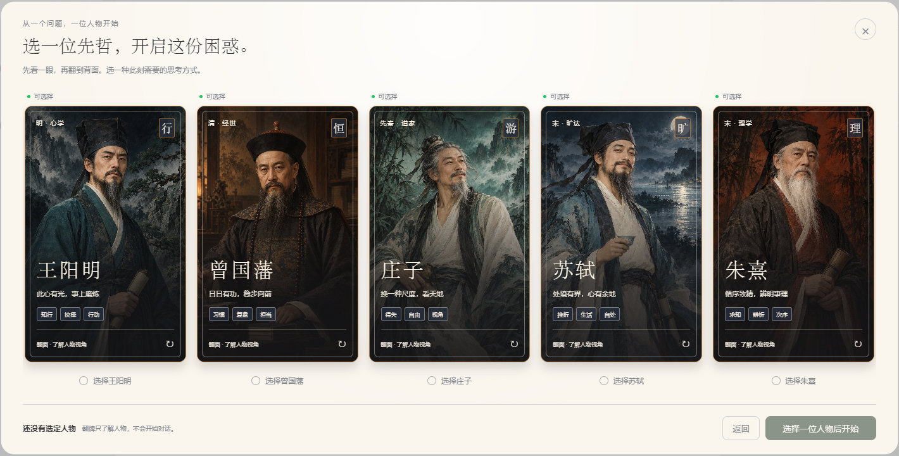
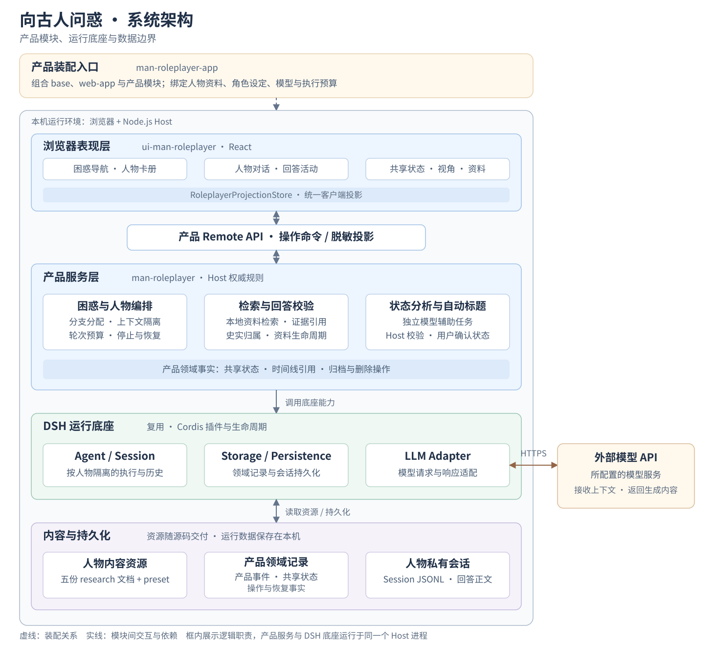

<div align="center">

# 向古人问惑 · Man-roles

### 把困惑说出来，借古人的视角重新想一想。

围绕同一份现实困惑，与王阳明、曾国藩、庄子、苏轼、朱熹对谈；切换思考视角，查看资料出处，逐步整理自己的判断。

[](packages/extensions/man-roleplayer/) [](packages/client/ui-man-roleplayer/) [](LICENSE)

[看看产品](#product-experience) · [本地运行](#run-from-source) · [设计与实现](#product-source) · [当前边界](#current-limits)

</div>



*实际产品界面，使用独立空数据环境截取。人物肖像为艺术演绎，卡片文案为产品化表达。*

这是一个个人 AI 产品原型，基于 [DeepSeek Harness](docs/reference/upstream/SOURCE.md) 扩展人物对话、资料依据和困惑管理，在本地浏览器中运行，使用你自己的模型服务账户。

<a id="product-experience"></a>

## 一份困惑，可以怎样聊

例如，你可以输入：“我知道该开始做，却总怕做得不够好。该怎么迈出第一步？”这是输入示例，实际回答由模型生成。

1. **选一位人物开始。** 翻看人物卡，按此刻需要的思考方式选择首位对谈者。
2. **围绕同一份困惑继续。** 可以邀请其他人物加入，比较不同视角；各人物保留自己的对话分支。
3. **核对依据，整理判断。** 查看回答关联的资料出处，确认或修改整理出的目标、约束与待讨论事项。

| 你想做的事 | 产品中的对应体验 |
| --- | --- |
| 对同一个问题换个角度想 | 五位人物可按需加入同一份困惑，无需每次重新描述背景 |
| 分清史料与当下建议 | 史实片段关联本地资料，现代推演单独标记；可查看出处、质疑或撤回资料依据 |
| 保留自己对处境的解释权 | 共享状态区分用户原文与模型推断；推断候选由用户确认，也可修改、拒绝或撤回 |
| 中断后接着聊 | 保存困惑与对话，支持刷新恢复、重命名、归档与恢复，以及经确认的永久删除 |
| 知道当前回答进行到哪 | 显示接收、生成、查阅资料和校验等活动；模型服务返回推理文本时可展开查看 |

<details>
<summary>五位人物，各自提供什么思考入口？</summary>

| 人物 | 产品中的思考入口 | 适合尝试的话题 |
| --- | --- | --- |
| 王阳明 | 内心判断与实际行动 | 知道道理却行动困难、在他人期待中失去判断 |
| 曾国藩 | 日常功课与持续复盘 | 目标太远、执行反复、难以建立秩序 |
| 庄子 | 松动得失与比较的尺度 | 被评价困住、想换一种方式理解处境 |
| 苏轼 | 在变化中安顿生活 | 失意、挫折、重新看见具体生活的价值 |
| 朱熹 | 分清概念，核对依据 | 问题混杂、判断依据不清、需要循序理解 |

这些是人物卡的产品化定位，不能代替对其思想的完整解释。人物回答受正式资料与角色设定约束，仍可能出现偏差。

</details>

<a id="product-source"></a>

## 产品设计与实现

产品层主要处理三个问题：如何让多个人物围绕同一份困惑对谈，如何让历史表述关联资料，以及如何把对话整理成用户可确认的状态。Agent 运行、模型适配和基础 Web 能力复用 DSH；下表列出本项目产品层的实现范围。

| 设计问题 | 实现方式 | 对应源码 |
| --- | --- | --- |
| 同一困惑下保留人物差异 | 按人物隔离 Session，共享获准的用户信息和已确认状态，不共享其他人物的私有回答 | [产品领域与上下文](packages/extensions/man-roleplayer/) |
| 让历史表述有可查看的依据 | 从五份本地人物资料检索，校验回答结构、史实片段与证据引用；支持资料质疑和撤回 | [检索与回答校验](packages/extensions/man-roleplayer/src/tools.ts)、[人物资料](research/) |
| 让用户掌握对话与状态 | 单一界面投影呈现对话、人物视角、资料和共享状态，操作由 Host 确认后生效 | [浏览器界面](packages/client/ui-man-roleplayer/) |
| 让产品能独立选择和启动 | 独立产品 profile 组合底座与产品模块，提供 Windows 启动及更新入口 | [产品装配](packages/bundle/man-roleplayer-app/)、[启动器](start-man-roles.cmd) |

### 系统架构



图中按逻辑职责分层：浏览器通过产品 Remote API 读取脱敏投影并提交操作；产品服务与 DSH 底座在同一个本地 Host 进程中运行。`man-roleplayer-app` 负责装配与部署绑定，`ui-man-roleplayer` 负责交互，`man-roleplayer` 负责产品规则。

人物分支按需创建，各自保留私有 Session；人物回答正文保存在 Session 历史中，产品事件记录时间线引用、共享状态与操作事实。状态分析与自动标题使用独立模型请求，其结果由 Host 校验，推断状态仍需用户确认。

底座来源、许可和本地集成边界见[源码来源](docs/reference/upstream/SOURCE.md)；更详细的类型、生命周期和上下文契约见各包 README。

<a id="run-from-source"></a>

<a id="install-and-build"></a>

## 在本地运行

准备 Git、Windows PowerShell、Node.js `^22.19.0 || >=24.0.0` 和 pnpm `11.7.0`，版本约束以 [package.json](package.json) 为准。首次安装需要网络和构建时间，真实对话需要你自己的 API key，并可能产生模型服务费用。

**1. 获取源码。** 推荐 Git 克隆，保留构建所需的提交信息。

```powershell
git clone https://github.com/K0848/Man-roles.git
cd Man-roles
```

**2. 安装并构建。** 所有命令均在仓库根目录执行，等待每一步成功后再继续。

```powershell
pnpm install --frozen-lockfile
pnpm run build
```

<a id="run"></a>

**3. 设置凭据并启动。** 将占位符替换成自己的 key，仅在当前 PowerShell 进程中设置，不写入公开文件。

```powershell
$env:DEEPSEEK_API_KEY = '<YOUR_DEEPSEEK_API_KEY>'
.\start-man-roles.cmd
```

打开 `http://127.0.0.1:3085/`，新建困惑并选择人物。默认 Provider 为 `deepseek-official`，模型为 `deepseek-v4-flash`；账户须支持所选模型。启动器前台运行，按 Ctrl+C 停止。

<details>
<summary>更新、启动参数与 ZIP 源码说明</summary>

普通启动复用已核验的同产品服务；其他进程占用端口时会报错。更新源码后使用 `-Update`：先构建，成功后再次核验并仅重启原产品进程；构建失败时保留正在运行的服务。参数由根 CMD 入口传给 [PowerShell 实现](scripts/start-man-roles.ps1)。

```powershell
.\start-man-roles.cmd -NoOpen
.\start-man-roles.cmd -Update -NoOpen
.\start-man-roles.cmd -Port 3086 -Model 'deepseek-v4-flash'
```

`-Model` 可选择其他受支持模型，底座适配器还读取可选的 `DEEPSEEK_BASE_URL`。源码、角色设定与人物资料均相对工程根定位。首次启动由 DSH 创建 `man-roles-mvp-web` profile，装配 base、web-app 和 man-roleplayer-app。

如果使用 ZIP 或不含 `.git` 的源码副本，构建前须将 `DSH_CLIENT_COMMIT_HASH` 设置为该副本的真实来源提交 SHA。Git checkout 可用 `git rev-parse HEAD` 查询；ZIP 接收者使用提供者注明的来源 SHA。不要使用随机值或与源码不符的旧 SHA；此值是公开构建元数据。

安装或构建失败时先处理错误，再启动。锁文件固定依赖解析，平台及原生依赖支持仍须在使用者机器验证。

</details>

<a id="local-data-and-privacy"></a>

## 数据与隐私

会话、设置与生成的 profile 默认保存在被 Git 忽略的 `.local/dsh-home/`。**对话推理通过配置的模型服务进行，相关文本和所需上下文会发送给该服务。** 请使用自己的凭据和空数据目录，不输入不应提供给该服务的敏感内容。

`-DshHome '其他本地目录'` 可指定独立数据位置，自定义目录须另外确保不进入版本控制。启动器不持久化 API key；底座凭据、设置功能和自行创建的文件仍须妥善保管。源码交付不包含作者的凭据、浏览器状态、用户对话、数据库或私人工作记录。

<details>
<summary>本机配置与公开交付边界</summary>

可选 `.local/launch.json` 保存本机 `Port`、`Provider`、`Model`、`DshHome` 和 `CredentialPatch` 绑定。显式参数优先于本地文件，本地文件优先于默认值；文件中的相对路径以工程根为起点。`CredentialPatch` 指向本机凭据补丁，空值可禁用补丁。

`.local/`、`.private/`、`.claude/` 和 `.validation/` 不进入 Git 和源码交付。`.gitignore` 只能保护匹配的未跟踪路径，无法清除已跟踪内容或历史提交；新 fixture 和截图仍须审查隐私内容。修改发布布局或忽略规则后，运行 `node scripts/verify-publish-ignore.mjs`，并单独审查实际暂存内容。

</details>

<a id="checks-and-development"></a>

## 验证与开发入口

仓库提供产品单元测试、隔离 Provider 的浏览器用例及启动器回归。流程测试用于核对上下文隔离、回答接收、恢复和生命周期等契约，真实人物质量、延迟与成本需要另行评测。

| 需要检查什么 | 入口 |
| --- | --- |
| 单元测试 | 在根目录执行 `pnpm test`，按文件或用例缩小范围 |
| Windows 启动行为 | `node --test scripts/start-man-roles.test.mjs` |
| 产品浏览器流程 | [H3 浏览器用例](apps/web/tests/man-roleplayer-h3.e2e.ts)，执行配置与前置条件见[测试说明](docs/development/testing.md) |
| 构建与运行更新 | `pnpm run build`；更新正在使用的产品入口执行 `start-man-roles.cmd -Update` |

<a id="current-limits"></a>

## 当前边界

- **人物回答由模型生成。** 有资料引用和结构校验仍可能理解错误，不能当作历史人物原话、史学定论或专业意见。
- **当前以 Windows 源码方式运行。** 尚不提供独立安装包；新机器安装、跨平台和长期运行未完成全面验收。
- **不承诺稳定延迟或效果提升比例。** 真实模型的完整质量、耗时与成本评测尚未完成；仓库没有可作为通过凭据的远端 CI 工作流。
- **当前未开放账号、云同步、网络搜索、跨困惑记忆或人物自动辩论。** 多人物切换围绕用户当前的同一份困惑进行。
- **持久化兼容需单独验证。** 不支持直接把作者的旧数据库当作可分发数据，也不宣称已完成生产部署或旧数据迁移验收。

<a id="origin-and-license"></a>

## 来源与许可

底座来自 [DeepSeek Harness](https://github.com/deepseek-ai/deepseek-harness)。保留原版权声明、[MIT 许可证](LICENSE)、[第三方声明](docs/legal/THIRD_PARTY_NOTICES.md)、[vendor 声明](vendor/README.md)及适用的第三方许可证。人物资料为项目整理材料，引用内容的权利仍归原权利人；来源与补丁维护见[源码来源](docs/reference/upstream/SOURCE.md)。
