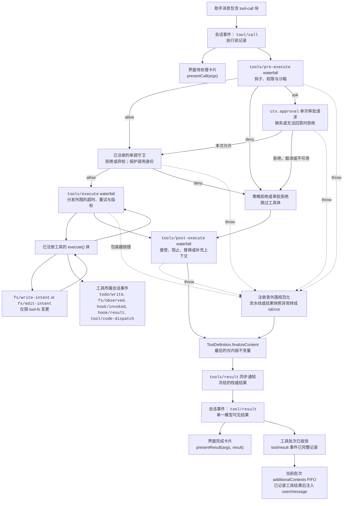

<!-- Generated by scripts/gen-doc-graphs.ts - do not edit by hand.
     Run `pnpm run gen-doc-graphs` to regenerate. -->

# 工具执行流程

此图展示策略、钩子、沙箱、文件系统守卫、结果重写、最终结果观察和 UI 渲染在不改变循环的情况下何时运行。`tools/pre-execute` waterfall（瀑布式事件）首先运行，随后是单调守卫，然后运行 `tools/execute` 和 `tools/post-execute` waterfall；这三个 waterfall 可以改写一次调用。由定义自身控制的 `finalizeContent` 和 `tools/result` 在此之后运行。

文件系统的先读后编辑检查位于 `tool-fs` 之下，通过 `fs/*` 事件实现。通用的前置／后置 waterfall 承载钩子与审批策略；`ctx.approval` 在单调守卫之前处理询问，而不得重新排序的所有者策略仍作为已注册的守卫。超时等环绕分发关注点对 `tools/execute` 进行包装。注册表会对候选结果进行无损快照；如果快照失败，则会先将失败规范化，之后再由可见定义中已随快照固定的 `finalizeContent` 回调强制执行其同步且仅限内容的不变式。随后，`tools/result` 会观察不可变、可由 JSON 无损表示的结果。这样一来，钩子便可跨越不同工具系列，而无需让工具与某个策略服务耦合。Code Mode 会将保留的 `run_code` 传输及其序列化子调用都送入流水线；子调用携带父级 token、记录 `tool/code-dispatch`、将拒绝呈现为具有约束力的驳回，并省略 `additionalContexts`，以保持调用与结果相邻。

维护方式：维护的 Mermaid 流程图；精确工具 Schema 与事件签名以生成目录为准。
